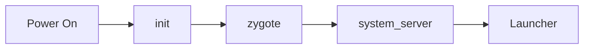

# GitHub2 Lego — Typora 主题验收

**测试项目：** 中英文混排、标题编号、代码块一体化、GitHub Alerts、表格、任务清单、Mermaid、公式、引用、旧版自定义标签。

[TOC]

## Android 系统架构概览

Android 14/15 Automotive OS（AAOS）文档通常需要解释 **SystemServer**、`SurfaceFlinger`、`binder`、`init.rc` 等组件的依赖。链接测试：[Typora 官方网站](https://typora.io/)。

### 代码块：多行应只有一个灰色外框

```java
public class BootProfiler {
    private static final String TAG = "BootProfiler";

    public static void main(String[] args) {
        long startedAt = System.nanoTime();
        // These three lines should be in ONE code block.
        System.out.println("AAOS startup trace");
        System.out.printf("elapsed: %.2f ms%n", (System.nanoTime() - startedAt) / 1e6);
    }
}
```

```bash
adb shell dumpsys SurfaceFlinger --latency
adb shell pidof system_server
adb shell cat /proc/meminfo | head -20
```

### GitHub Alerts

> [!NOTE]
> 如果看到普通引用块，请前往 Typora 设置启用 GitHub Style Alert。

> [!TIP]
> 先采集 Perfetto trace，再分析卡顿和调度时间线。

> [!IMPORTANT]
> 合并系统改动前应完成相应兼容性测试。

> [!WARNING]
> 不要在量产设备中随意关闭 SELinux。

> [!CAUTION]
> 性能参数可能受设备温度和后台任务影响。

### 兼容性矩阵

| 模块 | Android 14 | Android 15 | 备注 |
|:---|:---:|:---:|:---|
| SurfaceFlinger | ✓ | ✓ | 观察 `VSYNC` 和 BufferQueue |
| Binder / AIDL | ✓ | ✓ | 注意冻结进程与服务生命周期 |
| GKI | ✓ | ✓ | 检查内核 ABI 与厂商模块 |
| CTS/VTS | ✓ | ✓ | 回归中重点关注失败趋势 |

### 任务列表

- [x] 主题 CSS 已拆分为两个文件
- [x] 代码块保持单一外框
- [ ] 在 Typora 实机测试滚动着色过程

## 文档和阅读效果

这段内容用于检查长段落的可读性。中文和 English 混合排版应该平衡字重与行高；文字不应贴边，段落之间应保持稳定的视觉节奏。Reading 版应更舒适，Technical 版则更适合定位章节结构。

> “技术文档的价值不在于装饰，而在于让读者准确找到问题、理解原因并执行操作。”

行内代码：`adb shell dumpsys activity`、`android.hardware.graphics.composer3`。

### Mermaid（需要 Typora 开启 Diagram 支持）



### 数学公式（需要 Typora 开启 Math）

$$
T_{total}=T_{bootloader}+T_{kernel}+T_{userspace}
$$

### 旧版 MacDown 扩展

<note>这是旧版自定义 NOTE 标签，用于向后兼容。</note>

<warning>这是旧版 WARNING 标签，建议新文档优先使用 GitHub Alerts。</warning>

<hlblue>蓝色强调</hlblue> <hlgreen>绿色强调</hlgreen> <hlred>红色强调</hlred>

<details>
<summary>展开查看测试信息</summary>

这里的内容可以折叠，测试原主题的 details/summary 风格。

</details>

---

尾注测试[^1]。

[^1]: 来自主题验收文档，用于验证脚注外观。